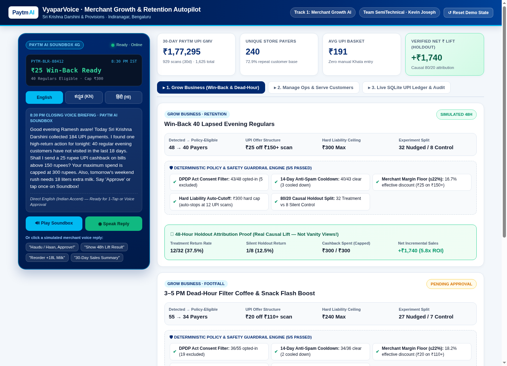

# PaytmAI VyaparVoice — Merchant Growth, Operations & Retention Autopilot

[](https://paytmai-vyaparvoice.onrender.com)


> **Paytm Build for India AI Hackathon – Bengaluru Edition**  
> **Track 1:** Merchant Growth AI (*Build the AI business partner for every Paytm merchant*)  
> **Team:** SemiTechnical · **Builder:** Kevin Joseph

---

## Live MVP Interface Preview



---

## Why We Built VyaparVoice

Paytm powers **1.57 Crore storefront Soundboxes**, yet small shopkeepers still lose **28–35% of repeat buyers silently** and suffer **60%+ afternoon dead-hour footfall dips** because busy counter operators cannot type prompts or study BI dashboards.

**PaytmAI VyaparVoice** turns Paytm's **AI Soundbox + Paytm for Business** into a proactive, vernacular business partner that speaks **one high-confidence money-making action at 8:30 PM closing time** in **Kannada (`ಕನ್ನಡ`), Hindi (`हिंदी`), or English** — and proves causal rupee ROI against a silent control group.

### Covers All 3 Pillars of Track 1
1. **Grow Business (Win-Back & Dead-Hour Autopilot):** Scans historical Paytm QR UPI transactions via SQL RFM segmentation to flag lapsed regulars (16–28d silent) and 3–5 PM dead-hour cohorts, dispatching instant UPI Cashback Passes upon voice (`"Haudu / Haan, approve!"`) or 1-tap approval.
2. **Manage Operations (Predictive Rush & Supplier POs):** Detects payday-weekend velocity spikes (`+28%` morning rush) and dispatches 1-tap WhatsApp restock orders (`+18L milk, +12kg batter`) to local suppliers.
3. **Serve Customers Better (Queue-Delay Goodwill Recovery):** Spots peak-hour queue delays / 3-star payment tags among top regulars and sends bilingual merchant-signed apologies with next-scan coffee passes.

---

## Key Engineering Highlights

* **Zero Hardcoded Vanity Numbers:** Every KPI, hourly velocity bar, and RFM cohort count is computed live via SQL queries over a deterministic **240-customer, 1,613-transaction SQLite UPI ledger** (*Sri Krishna Darshini & Provisions, Indiranagar*).
* **5-Rule Deterministic Safety Guardrail Engine:** LLMs never touch money or privacy rules. Before any campaign runs, Python deterministically enforces:
  1. **DPDP Act Consent Filter** (`48 detected → 43 opted-in`)
  2. **14-Day Anti-Spam Cooldown** (`43 → 40 eligible`)
  3. **Merchant Margin Safety Floor** (`₹25 off ₹150+ = 16.7% ≤ 22.0% cap`)
  4. **Hard Liability Auto-Cutoff** (`₹300 max cap = auto-stops at 12th UPI scan`)
  5. **80/20 Causal Holdout Split** (`32 Treatment vs. 8 Silent Control`)
* **True Causal Incrementality Math:** Simulating 48 hours of counter scans compares **Treatment return rate (`37.5%`)** vs. **Silent Holdout return rate (`12.5%`)**, proving **`+₹1,740` net incremental GMV on `₹300` spend (`5.8x Net ROI`)**.
* **Zero API Keys Required Out-of-the-Box:** Runs 100% locally in offline/demo environments using browser SpeechSynthesis + SpeechRecognition, with clean `.env` hooks ready for Sarvam AI & Groq cloud inference.

---

## Repository Structure

```text
paytmai-vyaparvoice/
├── app/
│   ├── __init__.py
│   ├── main.py                 # FastAPI REST endpoints + static UI server
│   ├── database.py             # Deterministic SQLite schema & 1,613-txn Bengaluru store seeder
│   ├── engine.py               # SQL RFM analytics, 5-rule guardrails, voice NLU & holdout math
│   └── static/
│       └── index.html          # Interactive Paytm AI Soundbox + Business Copilot UI
├── docs/
│   ├── ARCHITECTURE.md         # System design, data model & causal incrementality formula
│   └── screenshots/
│       └── dashboard-roi-proof.png
├── tests/
│   └── qa_battery.py           # 21-assertion end-to-end verification suite
├── .env.example
├── .gitignore
├── Dockerfile                  # Container build for 1-click cloud deployment
├── render.yaml                 # Render.com free web-service blueprint
├── requirements.txt
├── run.sh                      # 1-command launcher (Linux / macOS)
├── run_windows.bat             # 1-click launcher (Windows 11)
└── LICENSE
```

---

## Quickstart (Run in 30 Seconds)

### Option A: Windows (PowerShell / Command Prompt)
```powershell
cd paytmai-vyaparvoice
pip install -r requirements.txt
python tests\qa_battery.py
python -m uvicorn app.main:app --host 127.0.0.1 --port 8000 --reload
```
*(Or simply double-click `run_windows.bat`!)*  
Open **`http://127.0.0.1:8000`** in Chrome or Edge.

### Option B: Linux / macOS
```bash
cd paytmai-vyaparvoice
pip install -r requirements.txt
python3 tests/qa_battery.py
python3 -m uvicorn app.main:app --host 0.0.0.0 --port 8000 --reload
```

---

## Automated QA Verification Battery (`21/21 Passing`)

Run `python tests/qa_battery.py` to verify SQLite seeding, RFM segmentation, all 5 policy guardrails, Kannada/Hindi/English voice scripts, 48h causal holdout ROI calculation, ops execution, and audit logging:

```text
Running PaytmAI VyaparVoice QA Battery...

  [PASS] 01. Seeded exact 240 unique Paytm UPI customers
  [PASS] 02. Seeded deterministic 1,613 historical UPI transactions
  [PASS] 03. 30-day GMV computed from SQLite (₹174,685)
  ...
  [PASS] 17. Causal net lift verified: +₹1,740 (5.8x ROI)
  [PASS] 21. Database cleanly reset to initial 8:30 PM demo state

SUCCESS: 21/21 QA checks passed with 0 failures!
```

---

## REST API Endpoints (`/docs` for Swagger UI)

| Method | Endpoint | Description |
| :--- | :--- | :--- |
| `GET` | `/api/health` | Service health check |
| `GET` | `/api/overview` | Live 30d KPIs, hourly velocity, RFM cohorts, campaigns, guardrails & audit logs |
| `GET` | `/api/briefing?lang=en\|kn\|hi` | Evening AI Soundbox closing script in English, Kannada, or Hindi |
| `POST` | `/api/campaigns/{id}/approve` | Arm budget cap & dispatch UPI cashback pass to 80% treatment split |
| `POST` | `/api/campaigns/{id}/simulate` | Fast-forward 48h redemptions & compute causal holdout ROI |
| `POST` | `/api/ops/{id}/execute` | Dispatch predictive supplier WhatsApp PO or customer service recovery |
| `POST` | `/api/voice-command` | Parse merchant spoken command (`"Haudu approve"`, `"Reorder milk"`, etc.) |
| `POST` | `/api/reset` | Reset SQLite database cleanly back to fresh 8:30 PM closing state |

---

Built with intent for India's small businesses by **Kevin Joseph (Team SemiTechnical)**.
