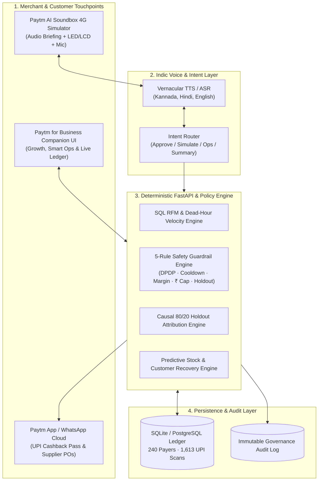

# System Architecture & Technical Design — PaytmAI VyaparVoice

**Hackathon:** Paytm Build for India AI Hackathon – Bengaluru Edition  
**Track 1:** Merchant Growth AI  
**Team:** SemiTechnical (`Kevin Joseph`)

---

## 1. Core Architectural Philosophy: Probabilistic Voice + Deterministic Money

Most merchant AI prototypes fail in production because they allow an LLM to hallucinate analytics numbers, invent arbitrary discounts, or message unconsented customers.

**PaytmAI VyaparVoice** enforces a strict separation of concerns:
1. **Vernacular Conversational Layer (Probabilistic):** Translates structured evening store insights into warm, natural **Kannada (`kn-IN`)**, **Hindi (`hi-IN`)**, and **Indian English (`en-IN`)** Soundbox briefings and parses short spoken merchant replies (`"Haudu, kaluhisi"`, `"Haan, bhej do"`, `"Approve"`).
2. **Financial, Privacy & Attribution Core (100% Deterministic):** Computes RFM cohorts directly from SQLite/PostgreSQL UPI transaction rows, validates 5 hard policy guardrails before dispatch, caps maximum rupee liability atomically, and proves true incremental revenue via a randomized **80/20 Treatment vs. Holdout Control** split.

---

## 2. Layered Architecture Diagram

---

## 3. Data Model (`app/database.py`)

| Table | Purpose | Key Columns |
| :--- | :--- | :--- |
| `customers` | Unique store UPI payers & privacy state | `customer_id`, `upi_handle`, `dpdp_consent`, `last_promo_days_ago`, `archetype` |
| `transactions` | Historical & simulated QR scan ledger | `txn_id`, `customer_id`, `amount`, `days_ago`, `hour_of_day`, `campaign_id`, `is_simulated` |
| `campaigns` | Closed-loop retention & dead-hour offers | `campaign_id`, `detected_count`, `eligible_count`, `treatment_count`, `holdout_count`, `offer_rupees`, `min_bill`, `max_budget`, `incremental_sales`, `roi_multiple` |
| `ops_actions` | Track 1 Operations & Customer Service actions | `action_id`, `pillar`, `title`, `recommended_step`, `est_value_inr`, `status` |
| `audit_logs` | Immutable compliance & attribution trail | `id`, `ts`, `actor`, `event_type`, `detail` |

---

## 4. The 5 Deterministic Policy Guardrails (`app/engine.py`)

Before any campaign can be dispatched, `compute_guardrails_for_campaign()` verifies:
1. **DPDP Act Consent Filter:** Excludes any payer with `dpdp_consent = 0` (`48 detected → 43 consented`).
2. **14-Day Anti-Spam Cooldown:** Excludes payers messaged within the last 14 days (`43 consented → 40 eligible`).
3. **Merchant Margin Safety Floor:** Ensures `offer_rupees / min_bill <= 22.0%` (`₹25 / ₹150 = 16.7% ≤ 22%`).
4. **Hard Liability Auto-Cutoff:** Locks `max_budget = ₹300` (`max 12 redemptions × ₹25`), preventing runaway discount cost.
5. **80/20 Causal Holdout Split:** Assigns `32` payers to Treatment and holds `8` payers in a silent Control group.

---

## 5. Causal Incrementality Formula

Instead of counting *gross* sales from all returning customers (which overstates ROI because some regulars would have returned organically), VyaparVoice computes **Net Causal Incremental GMV**:

$$\text{Expected Organic Returns} = \left(\frac{R_{\text{holdout}}}{N_{\text{holdout}}}\right) \times N_{\text{treatment}}$$

$$\text{Net Incremental Visits} = \max\left(0,\; R_{\text{treatment}} - \text{Expected Organic Returns}\right)$$

$$\text{Net Incremental Sales (₹)} = \text{Net Incremental Visits} \times \overline{\text{Bill}}_{\text{treatment}}$$

In the seeded Indiranagar Darshini simulation (`CMP-WINBACK-01`):
* **Control Return Rate:** $1 / 8 = 12.5\%$ → Expected organic returns in Treatment = $0.125 \times 32 = 4.0$ visits.
* **Actual Treatment Returns:** $12 / 32 = 37.5\%$ → **Net Incremental Visits** = $12 - 4 = 8.0$ visits.
* **Net Incremental Sales:** $8.0 \times ₹217.50 = \mathbf{+₹1,740}$ on **₹300** cashback spend = **5.8x Net ROI**.
